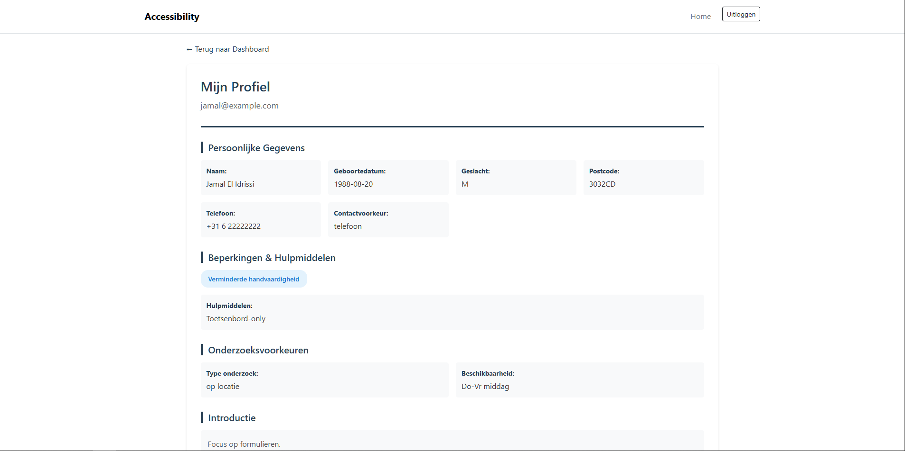

# Installatie + Setup
Volg de onderstaande stappen om de applicatie lokaal te runnen.
1. **Clone de repository:**\
``git clone https://github.com/Rac-Software-Development/wp2-2025-mvc-1b3-rubberducky.git``
2.  **Maak een Virtual Environment:**\
``python -m venv .venv``
3. **Activate Virtual Environment:**
- Windows:
``.venv\Scripts\activate``
- macOS/Linux:
``. .venv/bin/activate``
4. **Installeer de requirements.txt:**\
``pip install -r requirements.txt``
5. **Start de applicatie:**\
``python app.py``

# Inloggegevens
### Administrator
- Email: ``admin@hub.com``
- Password: ``admin``

### Organization
- Email: ``org-ah@hub.com``
- Password: ``secret``

### Ervaringsdeskundigen

#### Sanne Jansen
- Email: ``sanne@example.com``
- Password: ``secret``

#### Jamal El Idrissi
- Email: ``jamal@example.com``
- Password: ``secret``

#### Lotte van Dijk
- Email: ``lotte@example.com``
- Password: ``secret``

### Screenshots
\
\
\

### Bronnen
[Flask Tutorial Playlist](https://www.youtube.com/playlist?list=PL-osiE80TeTs4UjLw5MM6OjgkjFeUxCYH)\
[Flask Tutorial 2](https://www.youtube.com/watch?v=mqhxxeeTbu0)\
[Flexbox guide > navbar](https://css-tricks.com/snippets/css/a-guide-to-flexbox/)\
[Grid template colummns > responsive cards](https://css-tricks.com/snippets/css/complete-guide-grid/)\
[SQLite](https://www.youtube.com/watch?v=pd-0G0MigUA)\
[Flask Sessions](https://www.geeksforgeeks.org/python/how-to-use-flask-session-in-python-flask/)\
[Updating DB](https://www.youtube.com/watch?v=Wicjkn5_nIQ)\
[Forms](https://flask.palletsprojects.com/en/3.0.x/quickstart/#the-request-object)\
[Form validatie](https://developer.mozilla.org/en-US/docs/Learn/Forms/Form_validation)\

